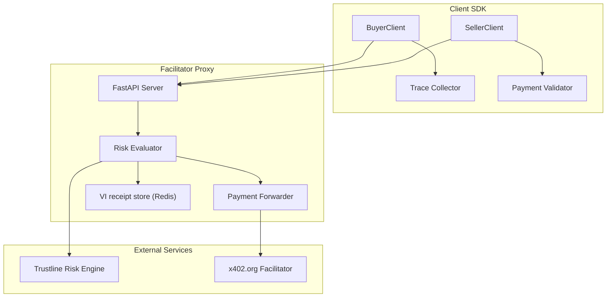
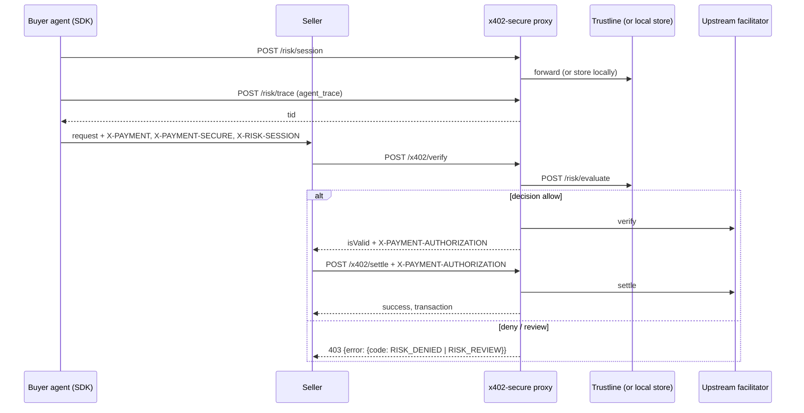

# Development & Deployment Guide

This guide is for developers who want to contribute to x402-secure or deploy their own instance.

## Table of Contents

1. [Architecture Overview](#architecture-overview)
2. [Development Setup](#development-setup)
3. [Self-Hosting Guide](#self-hosting-guide)
4. [Contributing](#contributing)
5. [Technical Details](#technical-details)

## Architecture Overview

### System Components



### Request Flow



## Development Setup

### Prerequisites

- Python 3.11 or 3.12
- `uv` package manager
- Git
- Docker (optional)

### 1. Clone Repository

```bash
git clone https://github.com/t54-labs/x402-secure
cd x402-secure
```

### 2. Install Dependencies

> **Important**: Use `uv sync` to install all workspace dependencies. This command installs the local packages (`x402-proxy` and `x402-secure`) in editable mode as defined in `[tool.uv.sources]` in the root `pyproject.toml`.

```bash
# Install uv if not already installed
curl -LsSf https://astral.sh/uv/install.sh | sh

# Create virtual environment and install dependencies
uv venv
source .venv/bin/activate  # On Windows: .venv\Scripts\activate
uv sync
```

The `uv sync` command:
- Installs all dependencies from `pyproject.toml` and `uv.lock`
- Automatically installs local packages (`x402-proxy` and `x402-secure`) in editable mode
- Ensures consistent dependency versions across environments

### 3. Environment Configuration

```bash
# Copy example env file
cp env.example .env

# Edit .env with your configuration
# Required for development:
PROXY_LOCAL_RISK=1  # in-memory risk sessions/traces; single process only
PROXY_PORT=8000
PROXY_UPSTREAM_VERIFY_URL=https://x402.org/facilitator/verify
PROXY_UPSTREAM_SETTLE_URL=https://x402.org/facilitator/settle
PROXY_PAYMENT_AUTHORIZATION_KEY=<generate with openssl rand -hex 32>  # at least 32 bytes

# Optional: forward /risk/* to Trustline instead of the local store
# PROXY_LOCAL_RISK=0
# RISK_ENGINE_URL=<TRUSTLINE_API_URL>
# RISK_ENGINE_COMPAT=trustline
# RISK_INTERNAL_TOKEN=<token>
```

Without `PROXY_PAYMENT_AUTHORIZATION_KEY`, `/x402/verify` and `/x402/settle` return 503. See `env.example.full` and `proxy/README.md` for every setting the proxy reads, including the VI receipt store (`X402_SECURE_VI_RECEIPT_*`).

### 4. Run Development Server

```bash
# Start the proxy server
uv run python run_facilitator_proxy.py

# In another terminal, start example seller
uv run uvicorn --app-dir packages/x402-secure/examples seller_integration:app --port 8010

# Run example buyer agent (needs BUYER_PRIVATE_KEY and OPENAI_API_KEY in .env)
AGENT_GATEWAY_URL=http://localhost:8000 \
SELLER_BASE_URL=http://localhost:8010 \
BUYER_EXPECTED_PAY_TO=<seller payTo address> \
BUYER_EXPECTED_ASSET=<asset address the seller quotes> \
BUYER_MAX_AMOUNT_ATOMIC=100000 \
uv run python packages/x402-secure/examples/buyer_agent_openai.py
```

### 5. Running Tests

```bash
# Run all tests
uv run pytest

# Run specific test file (without coverage check)
uv run pytest tests/test_core_flows.py --no-cov

# Coverage is configured in pytest.ini; the HTML report goes to htmlcov/
uv run pytest
```

## Self-Hosting Guide

### Option 1: Docker Deployment

```yaml
# docker-compose.yml (production example)
services:
  facilitator-proxy:
    build:
      context: .
      dockerfile: Dockerfile.production
    ports:
      - "8000:8000"
    environment:
      - PROXY_LOCAL_RISK=0
      - RISK_ENGINE_URL=<TRUSTLINE_API_URL>
      - RISK_ENGINE_COMPAT=trustline
      - RISK_INTERNAL_TOKEN=${RISK_INTERNAL_TOKEN}
      - PROXY_UPSTREAM_VERIFY_URL=https://x402.org/facilitator/verify
      - PROXY_UPSTREAM_SETTLE_URL=https://x402.org/facilitator/settle
      - PROXY_PAYMENT_AUTHORIZATION_KEY=${PROXY_PAYMENT_AUTHORIZATION_KEY}
      - X402_SECURE_VI_RECEIPT_REDIS_URL=${X402_SECURE_VI_RECEIPT_REDIS_URL}
    restart: unless-stopped
```

`Dockerfile.production` runs 4 uvicorn workers. Do not combine it with `PROXY_LOCAL_RISK=1`: the local risk store is per process.

```bash
# Build and start services
docker-compose up -d

# View logs
docker-compose logs -f facilitator-proxy
```

### Option 2: Manual Deployment

```bash
# On your server
git clone https://github.com/t54-labs/x402-secure
cd x402-secure

# Install dependencies (installs the local x402-proxy and x402-secure packages)
uv sync --no-dev

# Configure environment
export PROXY_LOCAL_RISK=0
export RISK_ENGINE_URL=<TRUSTLINE_API_URL>
export RISK_ENGINE_COMPAT=trustline
export RISK_INTERNAL_TOKEN=<token>
export PROXY_UPSTREAM_VERIFY_URL=https://x402.org/facilitator/verify
export PROXY_UPSTREAM_SETTLE_URL=https://x402.org/facilitator/settle
export PROXY_PAYMENT_AUTHORIZATION_KEY=<same secret on every replica, at least 32 bytes>
export X402_SECURE_VI_RECEIPT_REDIS_URL=redis://<host>:6379/0

# Run with multiple workers
uv run uvicorn run_facilitator_proxy:app --host 0.0.0.0 --port 8000 --workers 4
```


## Contributing

### Development Workflow

1. **Fork the repository**
   ```bash
   # Fork on GitHub, then clone
   git clone https://github.com/YOUR_USERNAME/x402-secure
   cd x402-secure
   ```

2. **Create a feature branch**
   ```bash
   git checkout -b feature/your-feature-name
   ```

3. **Make your changes**
   - Write tests for new functionality
   - Update documentation
   - Follow code style guidelines

4. **Run tests and linting**
   ```bash
   # Run tests
   uv run pytest

   # Run linting and format checks (the same checks CI runs)
   uvx ruff@0.8.4 check .
   uvx ruff@0.8.4 format --check .
   ```

5. **Submit a pull request**
   - Clear description of changes
   - Link to any related issues
   - Ensure CI passes

### Code Style

- Use Ruff for linting and formatting (`[tool.ruff]` in pyproject.toml); CI runs the same checks
- Type hints for all functions
- Docstrings for public APIs
- Meaningful variable names

### Testing Guidelines

See `tests/test_client_sdk.py` and `tests/test_core_flows.py` for the current test structure.

## Technical Details

### Client SDK Architecture

#### Trace Collection

```python
# How trace collection works internally
class OpenAITraceCollector:
    def __init__(self, coalesce: bool = True):
        self.events: List[Dict[str, Any]] = []
        self.coalesce = coalesce
        self.model_config: Dict[str, Any] = {}
        self.started_at: Optional[float] = None
        self.completed_at: Optional[float] = None

    def set_model_config(self, *, provider: str = "openai", model: str,
                         tools_enabled: Optional[List[str]] = None) -> None:
        """Set model configuration for trace context."""
        self.model_config = {
            "provider": provider,
            "model": model,
            "tools_enabled": tools_enabled or []
        }

    async def process_stream(self, stream, tools: dict) -> dict:
        """Process OpenAI stream and execute tools, collecting events."""
        # Processes stream, collects events automatically
        # Returns tool results
        pass

# Usage example
tracer = OpenAITraceCollector()
tracer.set_model_config(provider="openai", model="gpt-5-mini")

with client.responses.stream(model="gpt-5-mini", input=messages, tools=tool_defs) as stream:
    result = await tracer.process_stream(stream, tools=wrapped_tools)

# Recorded events are stored for risk upload
events = tracer.events
```

#### Risk Client

```python
# Risk session and trace management
class RiskClient:
    def __init__(self, base_url: str):
        self.base_url = base_url.rstrip("/")
        self.http = httpx.AsyncClient(timeout=15.0)

    async def create_session(self, *, agent_did: str,
                             wallet_address: Optional[str] = None,
                             agent_endpoint: Optional[str] = None,
                             app_id: Optional[str] = None,
                             device: Optional[Dict[str, Any]] = None) -> Dict[str, Any]:
        """Create a risk session with agent identification.

        Args:
            agent_did: Agent DID (current phase: often same as wallet; future: did:eip8004:...)
            wallet_address: EVM wallet address (0x...). Defaults to agent_did when
                agent_did is an EVM address; required otherwise.
            agent_endpoint: Optional agent callback/base URL
            app_id: Optional application identifier
            device: Device information dict

        Returns: Dict containing 'sid' (session ID) and other metadata
        """
        r = await self.http.post(
            f"{self.base_url}/risk/session",
            json={
                "agent_did": agent_did,
                "wallet_address": wallet_address,
                "agent_endpoint": agent_endpoint,
                "app_id": app_id,
                "device": device
            }
        )
        r.raise_for_status()
        return r.json()  # {"sid": "...", "expires_at": "..."}

    async def create_trace(self, *, sid: str, agent_trace: Dict[str, Any]) -> Dict[str, Any]:
        """Upload agent trace data linked to a session.

        Returns: Dict containing 'tid' (trace ID)
        """
        r = await self.http.post(
            f"{self.base_url}/risk/trace",
            json={"sid": sid, "agent_trace": agent_trace}
        )
        r.raise_for_status()
        return r.json()  # {"tid": "..."}
```

### Proxy Implementation

#### Header Processing

```python
# How the proxy processes payment security headers
from x402_proxy.headers import HeaderError, parse_risk_ids, parse_x_payment_secure

async def process_payment_headers(request: Request) -> dict:
    # Extract and validate required headers
    x_payment_secure = request.headers.get("X-PAYMENT-SECURE")
    x_risk_session = request.headers.get("X-RISK-SESSION")
    x_risk_trace = request.headers.get("X-RISK-TRACE")

    # A missing or invalid X-PAYMENT-SECURE is a 400 (TRACE_HEADER_INVALID)
    if not x_payment_secure:
        raise HeaderError("X-PAYMENT-SECURE required")

    # Parse session ID (required) and optional trace ID
    sid, tid = parse_risk_ids(x_risk_session, x_risk_trace)

    # Parse W3C trace context from X-PAYMENT-SECURE
    # Format: 'w3c.v1;tp=<traceparent>;ts=<url-encoded-tracestate>'
    tc = parse_x_payment_secure(x_payment_secure)
    # Returns: {"tp": "00-...-...-00", "ts": "..."}

    # Extract tid from tracestate if present and not in header
    extracted_tid = tid
    if not extracted_tid and "ts" in tc:
        try:
            from urllib.parse import unquote
            import base64, json
            ts_decoded = unquote(tc["ts"])
            ts_json = json.loads(base64.b64decode(ts_decoded))
            extracted_tid = ts_json.get("tid")
        except Exception:
            pass

    return {
        "sid": sid,
        "tid": extracted_tid,
        "trace_context": tc
    }
```

#### Risk Evaluation

```python
# Risk evaluation logic
async def evaluate_risk(context: dict, payment_context: dict) -> dict:
    # Build evaluation request
    evaluate_json = {
        "sid": context["sid"],  # Required: session ID
        "trace_context": context["trace_context"],  # Required: {"tp": "...", "ts": "..."}
        "payment": payment_context,  # Payment details
    }

    # Include tid if available (links to uploaded agent trace)
    if context.get("tid"):
        evaluate_json["tid"] = context["tid"]

    # Call Risk Engine (Bearer token when RISK_INTERNAL_TOKEN is set)
    token = os.getenv("RISK_INTERNAL_TOKEN")
    headers = {"Authorization": f"Bearer {token}"} if token else {}
    async with httpx.AsyncClient(timeout=10.0) as client:
        response = await client.post(
            f"{risk_engine_url}/risk/evaluate",
            json=evaluate_json,
            headers=headers,
        )

    if response.status_code != 200:
        raise HTTPException(status_code=response.status_code, detail=response.text)

    risk_data = response.json()

    # Response format:
    # {
    #   "decision": "allow" | "deny" | "review",
    #   "decision_id": "...",
    #   "ttl_seconds": 300,
    #   "reasons": ["..."],
    #   "risk_level": "low" | "medium" | "high",
    #   "used_mandate": false,
    #   "warnings": [],
    #   "extra": {}
    # }
    # Any decision other than "allow" makes /x402/verify answer 403 (RISK_DENIED / RISK_REVIEW).

    return risk_data
```

### Security Considerations

The proxy does not include rate limiting or a CORS policy. Add them at the gateway or load balancer in front of it.

## Support

- 🐛 Issues: [GitHub Issues](https://github.com/t54-labs/x402-secure/issues)
- 📧 Email: dev@t54.ai
- 🔒 Security reports: see [SECURITY.md](../SECURITY.md)
